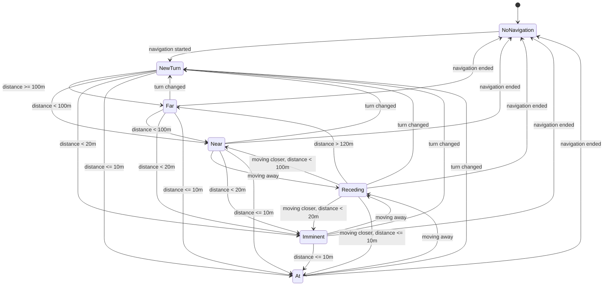

# State Machine for the buzz handler

Near, Imminent and At buzz on entry, i.e., only when moving closer to the turn. "Turn changed" means
that the turn symbol changed, or that the distance suddenly jumped up (a reroute, or the next turn
after passing one). "Moving away" means that the distance grew by a margin from the closest seen in
the state.

