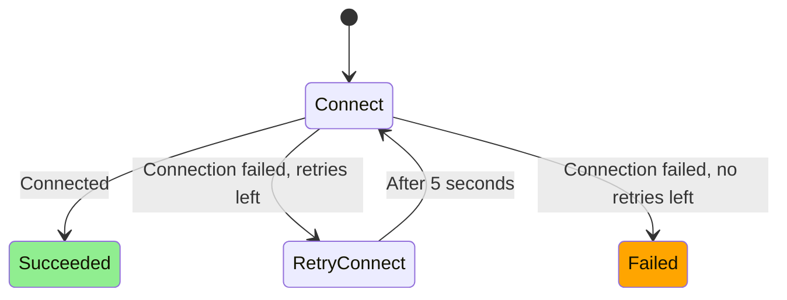

# Wifi connect state machine

Connects to one network, with retries. Used by the **Connecting** state of the
[wifi state machine](wifi_state_machine.md), which creates it with the network to connect to
on entry, and destroys it on exit. Connecting runs it on each evaluation, and acts on
**Succeeded** and **Failed**, which are final.

## States

- **Connect**: Connect to the network
- **RetryConnect**: Wait 5 seconds before retrying the connection (up to 3 retries)
- **Succeeded**: Connected to the network
- **Failed**: The connection failed, also after the retries
