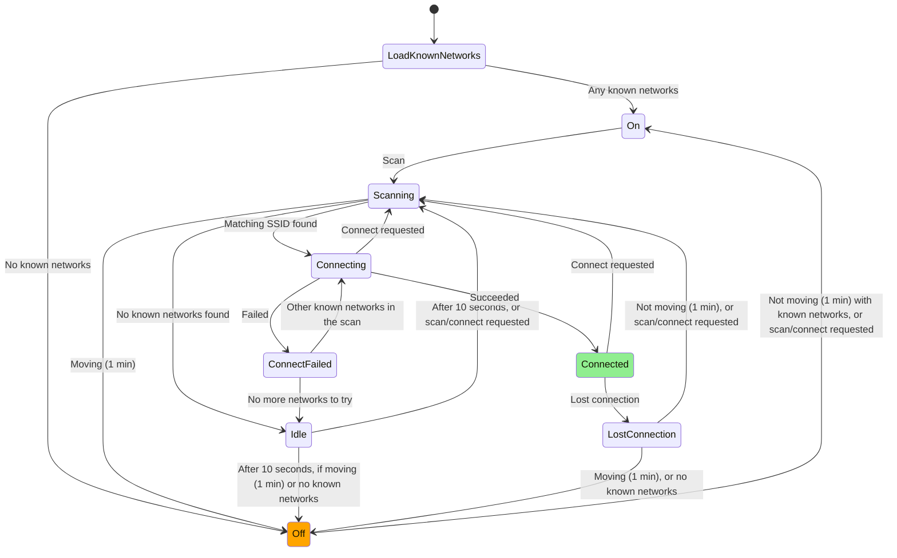

# Wifi state machine

The wifi handler connects to known networks (from `SSID.TXT` or the configuration) when the
moped is standing still, and turns off wifi when moving without a connection. An existing
connection is kept while moving, although it's expected to be lost soon. Without known
networks, wifi is kept off, except for requests.

The UI can request a scan (`MSG::start_wifi_scan`) or a network to connect to
(`MSG::wifi_connect`). A requested network is stored first among the known networks, so the
scan after the request picks it if it's in range.

## States

- **LoadKnownNetworks**: Import `SSID.TXT` to the configuration, if it has changed
- **On**: Turn on wifi
- **Off**: Turn off wifi. The result of an interrupted scan is ignored
- **Scanning**: Scan for networks. Requests during the scan are covered by it
- **Idle**: Wait for 10 seconds before scanning again, or turning off
- **Connecting**: Connect to the first known network in the scan, with retries, using the
  [wifi connect state machine](wifi_connect_state_machine.md). An ongoing attempt is
  stopped when leaving for a connect request. A scan request waits until the connection has
  succeeded or failed, since the wifi driver can't scan while connecting
- **ConnectFailed**: Skip the network until the moped has moved, or the wifi networks in the
  configuration have changed
- **Connected**: Connected to a network. A scan request scans without disconnecting, while a
  connect request disconnects and scans for the requested network
- **LostConnection**: The connection was lost
